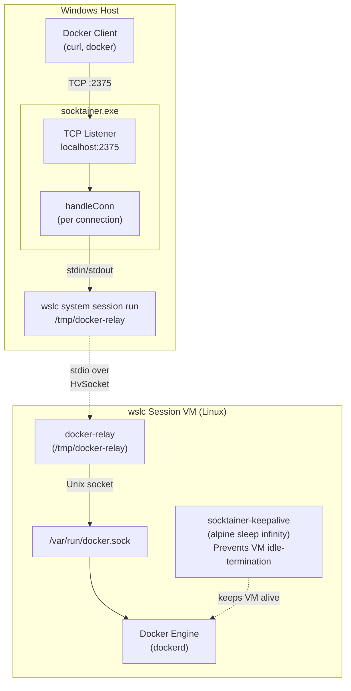
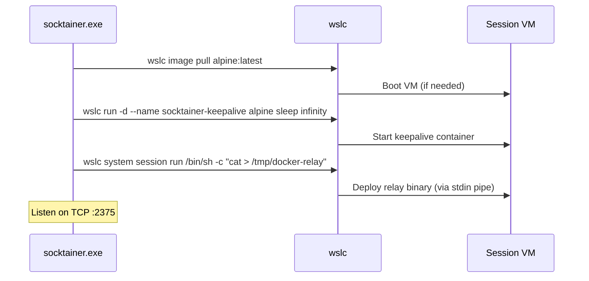
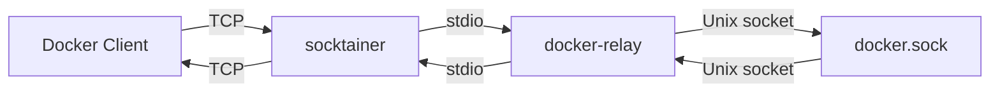

# wslc-proxy

Exposes the Docker API from a wslc session VM as a TCP endpoint on the Windows host.

## Architecture



### Bootstrap sequence



### Data flow (per connection)



## Usage

1. Build the relay (static Linux binary) and copy it to the working directory.
   Use `x86_64-unknown-linux-musl` instead on an x64 host:
   ```sh
   rustup target add aarch64-unknown-linux-musl
   cargo build --release -p docker-relay --target aarch64-unknown-linux-musl
   cp target/aarch64-unknown-linux-musl/release/docker-relay .
   ```

2. Build socktainer (Windows binary):
   ```sh
   cargo build --release
   ```

3. Run (from the directory containing `docker-relay`):
   ```sh
   ./target/release/socktainer.exe
   ```

4. Connect:
   ```sh
   curl http://localhost:2375/v1.44/containers/json
   DOCKER_HOST=tcp://localhost:2375 docker ps
   ```

## Testing

Tests use the built-in harness with [rstest](https://crates.io/crates/rstest) fixtures.

- **Proxy tests** run socktainer against a fake `wslc` (`socktainer/examples/fake_wslc.rs`), so they work on any OS without WSL:
  ```sh
  cargo test
  ```

- **End-to-end tests** run socktainer against the real `wslc` and the Docker engine in the session VM. They need `docker-relay` in the repository root (see step 1 above):
  ```sh
  cargo test --test e2e -- --ignored
  ```

Two environment variables override socktainer's defaults, mainly for the tests: `SOCKTAINER_LISTEN` (listen address, default `localhost:2375`) and `SOCKTAINER_WSLC` (the `wslc` executable to run).
