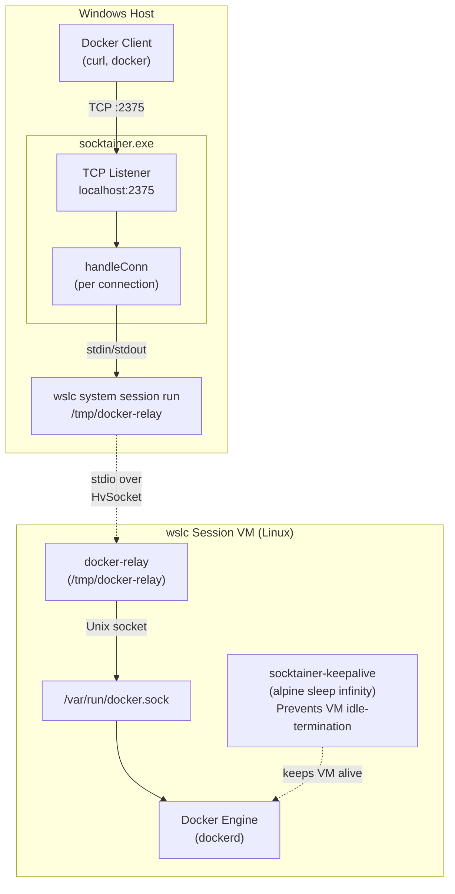
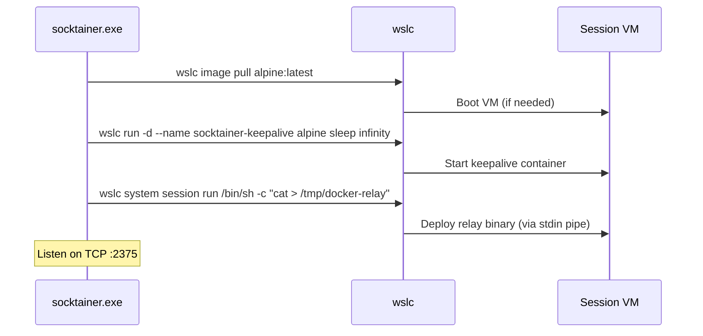
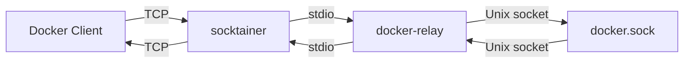

# wslc-proxy

Exposes the Docker API from a wslc session VM as a TCP endpoint on the Windows host.

## Architecture



### Bootstrap sequence



### Data flow (per connection)



## Usage

1. Build the relay (Linux binary):
   ```sh
   GOOS=linux GOARCH=arm64 CGO_ENABLED=0 go build -ldflags '-s -w' -o docker-relay ./cmd/relay/
   ```

2. Build socktainer (Windows binary):
   ```sh
   go build -o socktainer.exe ./cmd/socktainer/
   ```

3. Run:
   ```sh
   ./socktainer.exe
   ```

4. Connect:
   ```sh
   curl http://localhost:2375/v1.44/containers/json
   DOCKER_HOST=tcp://localhost:2375 docker ps
   ```
